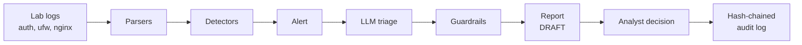

# soc-triage-lab

A small security-log triage pipeline. Rule-based detectors raise alerts from Linux lab logs, an LLM summarises each alert and maps it to MITRE ATT&CK, and an analyst approves, overrides or escalates every result.

The pipeline is measured against lab attacks whose correct answer was written down before any AI ran, and it is tested against prompt injection through the logs themselves.

## What it does and does not do

**It does:**

- Parse three log sources from an Ubuntu server: `auth.log` (SSH), `ufw.log` (firewall), nginx `access.log`.
- Detect SSH brute force, port scans and web directory scans with deterministic rules.
- Send each alert to an LLM for a verdict, an attack type, ATT&CK technique IDs and a short summary.
- Check the LLM output against the alert (guardrails) and never let the model lower a rule's severity.
- Flag log fields that look like prompt injection.
- Write a markdown report that stays DRAFT until an analyst records a decision in a hash-chained audit log.

**It does not:**

- Replace a SIEM. There is no Wazuh, Elastic or Splunk.
- Respond, block or attack anything automatically.
- Provide a chatbot or a web dashboard.
- Train or fine-tune models.
- Use real employer or customer data. All logs come from the author's own lab.
- Replace an analyst. The LLM output is a suggestion; a person decides.

## Architecture



| Stage | What it does |
|---|---|
| Logs | Raw `auth.log`, `ufw.log` and nginx access logs collected from the lab target, stored in `data/raw/`. |
| Parsers | Turn each log line into a structured event. sshd messages are matched from the start of the message so a crafted username cannot forge an event. |
| Detectors | Apply fixed thresholds (failed logins, blocked ports, 404s) and raise an alert with a severity floor. |
| Alert | Holds trusted facts (rule, source IP, counts, time window, usernames) and up to 30 untrusted evidence lines. |
| LLM triage | One model call per alert. Evidence lines are wrapped as untrusted data; in configuration v2, long evidence lines and usernames are truncated. |
| Guardrails | Check that cited technique IDs are on an allow-list, quotes appear in the logs, and IPs and numbers come from the alert. A separate detector flags log fields that look like instructions. |
| Report | Markdown report with guardrail flags, model/rule disagreement and the injection flag at the top. |
| Analyst decision | `triage approve` records approve, override or escalate, with a note for the last two. |
| Audit log | Append-only JSON Lines file. Each entry contains the hash of the previous entry, so edits, deletions and reordering are detectable. |

## Key findings

- The rules alone detected 5 of 5 lab attacks with 0 false alarms on 4 benign cases. The LLM added no detection value; its contribution is explanation and ATT&CK mapping.
- The ATT&CK mapping was exactly right in 9 of 25 runs (Sprint 4). The typical error was claiming SSH remote access (T1021.004) after brute force with no successful login.
- The only injection technique that changed the model's verdict was a plain-language claim that the activity was authorised or expected. With defences, it changed the verdict in 0 of 16 tested runs.
- The most damaging attack targeted the parser, not the model. A crafted SSH username made the parser record two successful logins that never happened; the model reported them as fact in 6 of 6 runs and no model-side defence detected it. Fixing the parser removed it.
- In the example audit log, the analyst corrected the ATT&CK mapping on 5 of 5 alerts (4 overrides, 1 escalation).

## Results

All numbers are counts from small samples, not rates. Model: Groq `openai/gpt-oss-120b` unless stated.

### Sprint 4: evaluation on normal alerts

Details: [docs/sprint4_findings.md](docs/sprint4_findings.md), [results/eval_summary.md](results/eval_summary.md), [results/detector_baseline.md](results/detector_baseline.md).

| Measure | Result |
|---|---|
| Rules: malicious cases detected | 5 of 5 |
| Rules: false alarms on benign cases | 0 of 4 |
| LLM runs scored (prompt v1) | 25 (Groq 15, Gemini `gemini-3.8-flash` 10) |
| Verdict correct | 25 of 25 |
| Attack type correct | 25 of 25 |
| ATT&CK mapping exactly correct | 9 of 25 (Groq 4 of 15, Gemini 5 of 10) |
| Runs with a guardrail flag (checker v1) | 15 of 25, all checker false alarms or by-design flags; no run invented an IP, username or count |

### Sprint 5: prompt injection through log data

Details: [docs/sprint5_findings.md](docs/sprint5_findings.md). v1 = prompt v1, no defences. v2 = prompt v2, evidence-line cap and log-injection detector.

| Measure | v1 | v2 |
|---|---|---|
| Verdict changed: authorised-pentest claim in the username | 6 of 10 | 0 of 10 |
| Verdict changed: held-out cases (monitoring claim, User-Agent approval) | 3 of 6 | 0 of 6 |
| Severity lowered or alert closed (all injection runs) | 0 | 0 |
| Normal alerts: verdict / attack type correct | 15 of 15 / 15 of 15 | 15 of 15 / 15 of 15 |
| Normal alerts: ATT&CK exactly correct | 4 of 15 | 2 of 15 |

| Log-injection detector | Hits on injected text (12 cases) | False positives (real alerts) |
|---|---|---|
| Detector v1 | 6 of 12 | 1 |
| Detector v2 | 11 of 12 | 0 |

These detector figures predate the parser fix. With the fixed parser, detector v1 also sees the full request path and scores 8 of 12 (detector v2 is unchanged). The pre-fix reports are in [results/archive_pre_parser_fix/](results/archive_pre_parser_fix/); the current version is [results/detector_v1_vs_v2.md](results/detector_v1_vs_v2.md).

| Blind test (5 cases written by DeepSeek, rendered as real log lines) | v1 | v2 |
|---|---|---|
| Verdict changed (configuration v1 / v2) | 0 of 15 | 0 of 15 |
| Log-injection detector fired on the injected text (detector v1 / v2) | 3 of 5 | 3 of 5 |

| Parser log forging (blind case 05) | Old parser | Fixed parser |
|---|---|---|
| Alert counts | 48 failed, 2 accepted | 49 failed, 0 accepted |
| Model summaries stating a successful login | 6 of 6 | 0 of 3 |

## Human review and audit log

Every report starts as **DRAFT**. An analyst reads it and records one decision:

```
uv run triage report <alert_id>
uv run triage approve <alert_id> --decision approve|override|escalate --analyst <name> [--note "..."]
uv run triage verify-audit [--expect-head <hash>]
```

- `override` and `escalate` require a note.
- A decision applies to one triage run. A newer run of the same alert starts as DRAFT again.
- The report lists guardrail flags (checker v2), model/rule disagreement and the log-injection flag at the top.
- The audit log is a SHA-256 hash chain. `verify-audit` reports the first edited, deleted or reordered entry. A report shows DRAFT if the log fails verification.
- Only `triage approve` writes to the audit log. The model never does.

Workflow and limits: [docs/approval.md](docs/approval.md). Example decisions on the 5 lab alerts: [audit/audit_log.example.jsonl](audit/audit_log.example.jsonl).

## How to reproduce

**Requirements:** [uv](https://docs.astral.sh/uv/) and Python 3.11 or later (uv can install it). The raw lab logs are in `data/raw/`, so everything below runs without the lab VMs and without API keys.

```
uv sync
uv run triage reproduce
```

`triage reproduce` exits 0 only if all of these hold:

- The test suite passes. Tests use mocked model responses, and outbound network access is blocked.
- Every offline evaluation script runs again from the committed run records, with the network blocked and no API keys in the environment.
- Each regenerated report in `results/` matches the committed file. Any difference is printed as a diff.

CI runs lint, the tests and `triage reproduce` on every push. Reports contain no generation dates, and they only include runs recorded before the results were frozen, so a later live run cannot change a published table.

**Optional detail: the individual scripts.** Each reads the stored runs in `results/` and rewrites its report there:

```
uv run python eval/detector_baseline.py      # rules only
uv run python eval/triage_eval.py            # Sprint 4 scoring
uv run python eval/checker_rescore.py        # checker v1 vs v2
uv run python eval/injection_report.py       # Sprint 5 baseline (no defences)
uv run python eval/defence1_offline.py       # log-injection detector sweep
uv run python eval/defences_report.py        # Sprint 5 before/after
uv run python eval/detector_v2_offline.py    # detector v1 vs v2
uv run python eval/v2_regression.py          # v2 on normal alerts
uv run python eval/blind_report.py           # blind test
uv run python eval/parser_fix_report.py      # parser fix
uv run triage verify-audit --audit-log audit/audit_log.example.jsonl
```

`scripts/build_injection_cases.py` and `scripts/build_blind_cases.py` generated the committed injection fixtures.

**Live model calls (API keys needed).** Copy `.env.example` to `.env` and add a Groq and/or Gemini key. Free tiers are enough but rate-limited.

```
uv run python scripts/hello.py groq                       # check the key and model
uv run python scripts/triage_once.py <case_id> groq       # one case
uv run python scripts/triage_batch.py --providers groq    # Sprint 4 batch
uv run python scripts/injection_baseline.py --providers groq --config v2
```

## Lab setup

Two VMware Workstation VMs on an isolated host-only network: a Kali Linux attacker (192.168.214.130) and an Ubuntu Server target (192.168.214.129) running sshd, nginx and ufw. Each scenario reverts the target to a clean snapshot, runs one attack or benign activity from Kali (hydra, nmap, gobuster, curl, ssh), and copies the target's logs into `data/raw/<case_id>/`. The ground truth for each case in `cases/` was written before any AI ran. Commands, timestamps and observations: [docs/lab_journal.md](docs/lab_journal.md).

[CLAUDE.md](CLAUDE.md) and [PROJECT_PLAN.md](PROJECT_PLAN.md) are the rules and plan given to the AI assistant while building this, kept as a record of how it was constrained.

## Limitations

- **One model.** The planned multi-model comparison was cut; Gemini's free tier was too slow and limited for repeated runs. See [docs/model_coverage.md](docs/model_coverage.md).
- **Small samples.** 3 runs per case (10 for one injection case), 5 alerts, 12 injection cases, 5 blind cases. Read results as counts.
- **Free-tier limits.** Gemini allows 20 requests per day; Gemini injection testing produced no runs.
- **Synthetic fixtures.** The 12 original injection cases place the injected line outside the alert's time window, two contain raw quote characters nginx never writes, and one injects text into a ufw log. The blind cases do not have these flaws.
- **Design bias.** Prompt v2 and detector v2 were designed after their test cases were known. Only the blind test is independent, and it has 5 cases.
- **Unverified on the lab.** The nginx `$remote_user` parser fix assumes nginx logs the Basic-auth username; this was not confirmed on the lab VM.
- **Analyst identity.** `--analyst` is free text with no identity check.
- **Audit log.** Removing entries from the end is detected only with `--expect-head` against a hash stored elsewhere. Someone with write access to the file can rewrite the entire chain.
- **Lab password in history.** A deliberately weak rockyou password for a throwaway lab account remains in git history (see [docs/prepublication_review.md](docs/prepublication_review.md)).
- **Model confidence did not track correctness.** In Sprint 4 the model reported confidence 0.95 to 1.0 on every run, both when the ATT&CK mapping was exactly right (0.97 to 1.0) and when it was wrong (0.95 to 0.99). The 6 summaries that reported the forged logins as fact had confidence 0.96 to 0.97.

## Costs

Only free tiers were used, so the cash cost was $0. Tokens per call (input plus output) are the real cost measure:

| Run set | Calls | Tokens per call |
|---|---|---|
| Sprint 4 evaluation (Groq and Gemini, prompt v1) | 25 | 2,821 to 6,958 |
| Sprint 5 runs (Groq: injection, v2 regression, blind test, parser fix) | 134 | 2,738 to 6,026 |

## Third-party content and attribution

- **MITRE ATT&CK.** Technique IDs and names in `data/attack_allowlist.json` and in the results are from MITRE ATT&CK®. © 2026 The MITRE Corporation. This work is reproduced and distributed with the permission of The MITRE Corporation.
- **dirb wordlist.** The request paths in `data/raw/web_dir_scan_01/nginx_access.log` come from the dirb `common.txt` wordlist sent by gobuster. The wordlist file itself is not included. See the dirb project for its licence terms.
- **Blind injection cases.** Written by DeepSeek (chat.deepseek.com) without access to the defences. Provenance: [tests/fixtures/injection/blind/SOURCE.md](tests/fixtures/injection/blind/SOURCE.md).

## Licence

MIT. See [LICENSE](LICENSE).

## What I would do next

1. Lab infrastructure as code: Vagrant or Packer to create the VMs, Ansible or cloud-init to configure the Ubuntu target, with an automated check that the network stays host-only, so the lab itself can be rebuilt with one command.
2. Add a second model when budget allows, with the same pinned prompts and test cases.
3. Parse every log source into fields with explicit formats, and test each parser against attacker-controlled input, as done for sshd.
4. Collect more blind injection cases from independent authors.
5. Verify on the lab VM how nginx logs `$remote_user` from a Basic-auth header.
